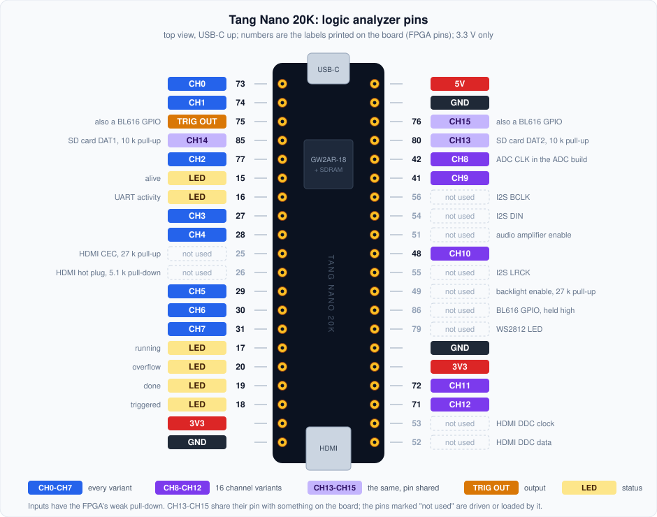

# oxla-tn20k: a logic analyzer on the Tang Nano 20K

A logic analyzer for the Sipeed Tang Nano 20K, in Verilog, built with the
open toolchain (yosys, nextpnr-himbaechel, apycula). 8, 14 or 16 channels, up to
270 MS/s, two million words of sample memory in the FPGA package's SDRAM, run
length encoding, and a two-term trigger (A, B, A or B, A and B, A then B, B
then A, each with an event count).

Status: the gateware simulates and runs on a board; the checks are listed
under [What has been checked](#what-has-been-checked). The oxrok driver for
it, `oxla`, is written and not yet released. `tools/oxla.py` is a bring-up
tool that speaks the protocol and is the reference for that driver.

## The board

Sipeed Tang Nano 20K: a Gowin GW2AR-LV18QN88C8/I7 and a Bouffalo BL616 that
is the USB debugger.

| | |
|---|---|
| Logic | 20,736 LUT4, 15,552 flip-flops, 46 block RAMs of 18 kbit (828 kbit), 2 PLLs |
| SDRAM | 64 Mbit SDR SDRAM, 32 bit wide, inside the FPGA package: 4 banks × 2048 rows × 256 columns = 2^21 words. Its pins are not bonded out; nextpnr places the `O_sdram_*` and `IO_sdram_dq` ports by name |
| Flash | 64 Mbit SPI, holds the bitstream |
| Clock | 27 MHz crystal on pin 4. An MS5351 gives three more clocks, set from the BL616's console, not used here |
| USB | BL616: JTAG, a UART (FPGA pins 69 TX, 70 RX) and four more lines to the FPGA (pins 13, 75, 76, 86) that its stock firmware does not use. It shows as an FTDI 0403:6010 with two serial ports; the second is the UART |
| I/O | 3.3 V LVCMOS on the headers. Not 5 V tolerant |
| ADC | None. See [Analog](#analog) |

What this design uses of it: about 10% of the logic, one block RAM, both PLLs,
all of the SDRAM.

The gateware has no say over the USB link, and it is the slow part: the
stock BL616 firmware takes 3 Mbaud but passes about 80 kB/s to the host, and
drops bytes when more than about 10 kB arrive in one go. So the device sends
only what it is asked for and the host asks for 8 kB at a time. Reading the
whole memory takes 105 s; a capture of 100,000 words, 5 s.

## Pins

The 14 channel variants use CH0-CH13. The 8 channel variants need only the
left header, which also has trigger
out, 3V3 and ground. The channels have the FPGA's weak pull-down. Trigger
out is high from the trigger to the end of the capture.

Which pins are free was read off Sipeed's schematics (rev 3921 and rev
3923, which agree on all of this) and then checked on a board by pulling
each pin low for half a microsecond and watching what it did next:

- CH0-CH12 go to the header and nowhere else, except to the LCD connector:
  27-31, 41, 42, 48 and 77 are LCD signals, so this is not for a board with
  an LCD plugged in.
- CH13 and CH14 (80, 85) are the SD card's DAT2 and DAT1, with 10 k
  pull-ups to 3.3 V. Fine as inputs with no card in the slot; they read
  high when nothing drives them.
- CH15 (76) and trigger out (75) also go to two BL616 GPIOs, the SPI link
  the debugger has to the FPGA besides JTAG and the UART. The stock
  debugger firmware leaves both floating (measured). Another firmware for
  the BL616 may not.
- 86 is the third line of that link and the BL616 holds it high. 49 enables
  the LCD backlight converter and has a 27 k pull-up. 25 and 26 are HDMI
  CEC and hot plug, through resistors. 51, 54, 55, 56 are the audio
  amplifier, 79 the WS2812, 52 and 53 the HDMI DDC lines. None of these is
  used.

## Variants

One source, parameters per bitstream (`VARIANTS` in the Makefile):

| variant | channels | max rate | RLE | |
|---|---|---|---|---|
| `la16-rle` | 16 | 135 MS/s | yes | the general one |
| `la16` | 16 | 135 MS/s | no | |
| `la14-ddr` | 14 | 270 MS/s | no | two samples per clock; CH0-CH13 |
| `la8-rle` | 8 | 135 MS/s | yes | twice the depth in raw mode |
| `la8-ddr` | 8 | 270 MS/s | no | two samples per clock |
| `la8-adc` | 8 | 67.5 MS/s | no | the channels are a parallel ADC's data, with its clock on pin 42 |

The clock is not a build option: the host sets it to 81, 108 or 135 MHz
(27 MHz times 3, 4 or 5; there is no setting that gives exactly 100), and
the sample rate is the clock divided by a whole number, or twice the clock
in the two-samples-per-clock variants. Together that is 135, 108, 81, 67.5,
54, 45, 40.5, 36, 33.75, 27 MS/s and on down. The device reports its clock
and the host does the division.

The capture logic has a PLL of its own for this. The host side (UART,
commands, readout) is on a second PLL that never changes, so the link
survives a change of clock; the two sides meet through synchronizers. A
first attempt ran the host side straight off the 27 MHz crystal and lost
about one command in thirty: nine clocks per bit at 3 Mbaud is too few for
the board's USB bridge.

nextpnr's timing report is not the last word on whether a build works. At
135 MHz, builds that it passed at 150, 170, even 200 MHz misbehaved on the
board, each in its own repeatable way: a word count one too high, one byte
of every word zero, a trigger that never fired. Three places in the logic
were behind it (logic straight off a block RAM's output, a word built and
written in one clock, two subtractions and comparisons chained for two
samples per clock) and each now has a register or does the work in
parallel. The Makefile also asks nextpnr for 15% more than the fastest clock
(`MARGIN`), so a marginal build fails to build; `SEED=n` then tries another
placement. A variant whose default placement falls short can have the seed
that made it as a last field in `VARIANTS`; none needs one at present. Run
the self test on a new build all the same; it tries every clock.

Fourteen is as many channels as fit at two samples per clock: the SDRAM
takes a little under one 32 bit word per clock, 14 channels twice a clock
are 28 bits, and 16 would be 32. The 14 channel variants pack samples
across word boundaries to get there, and hold 4,793,488 samples.

RLE is both a build option and a switch at run time, so an RLE bitstream
also does raw captures. Raw mode holds 4,194,304 samples of 16 channels or
8,388,608 of 8. RLE holds 2,097,152 runs, each up to 65,536 samples long
with 16 channels and 16,777,216 with 8.

RLE has a limit that raw mode does not: a signal that changes on nearly
every sample needs a word per sample, the memory takes a little under one
word per clock, and so at the full clock rate such a capture overflows (it
says so; it does not write bad data). From half the clock rate down, RLE
cannot overflow.

## Build

    make venv           # once: apycula and nextpnr (the YoWASP build) into .venv
    make                # every variant, about a minute each
    make la16-rle       # one
    make sim            # Verilator, seven configurations
    make prog V=la16-rle          # into the FPGA, until power off
    make flash V=la16-rle         # into the flash

Needs yosys (0.48 here), Verilator 5 for the simulation, openFPGALoader to
program, uv for `make venv`.

    tools/oxla.py /dev/cu.usbserial-XXXX1 id
    tools/oxla.py /dev/cu.usbserial-XXXX1 selftest
    tools/oxla.py /dev/cu.usbserial-XXXX1 capture --mode a-then-b --a 0=r --b 1=f,2=1
    tools/oxla.py --clock 135 /dev/cu.usbserial-XXXX1 capture --ddr

## How it works

    pins -> sampler -> trigger -> packer -> FIFO -> SDRAM <- readout <- UART

The sampler synchronizes the pins and divides
the rate. The trigger matches both terms on every sample and runs the
sequence. The packer turns samples into 32 bit words, raw or run length
encoded, and marks the word with the trigger sample. The SDRAM is a ring
that is written all the time; the trigger does not start anything, it starts
the count of what is still to come, which is what gives pre-trigger data for
free. The host reads backwards from where the writing stopped.

Three things in the SDRAM controller are particular to this use:

- Writes are single-word writes on consecutive clocks, so a row takes a word
  per clock for as long as there is data, and auto refresh is slotted in
  between rows. No refresh is ever skipped, so a capture can wait for its
  trigger for a day.
- A read issues the same READ six clocks running and samples DQ in the
  middle of the six clocks the word is then on the bus. Reads are thousands
  of times faster than the UART needs anyway, and this way they work at any
  clock without tuning.
- DQ is driven for the whole time a row is open for writing. Switched per
  word, the first word of every burst was wrong on the board.

The SDRAM clock is the PLL's second output, through an ODDR cell, and its
phase after the system clock is a build setting (`SD_PHASE`, in sixteenths
of a period), because the other SDRAM outputs are routed from fabric
flip-flops and nextpnr does not time them to the pad. Measured on one board,
on three different builds, writing and reading back
200,000 words: settings 10, 12, 14 and 0 work and 2, 4, 6 and 8 do not, the
same at 108 and 135 MHz. The default is 13, the middle. A build that fails
the memory part of the self test wants this looked at first.

The protocol is in [docs/PROTOCOL.md](docs/PROTOCOL.md).

## Analog

The GW2AR-18 has no ADC (Gowin's Arora V parts do; this is not one), and the
board adds none. The BL616 has a 12 bit ADC of its own but its pins do not
reach the headers and its firmware is the debugger. So analog needs
something on the header:

- A parallel ADC module (AD9280 or AD9226 class, 8 or more bits, tens of
  MS/s). `la8-adc` is for that: data on CH0-CH7, the sample clock out on
  pin 42, high for the first half of each sample period, and the ID says the
  channels are one analog value. Rates are 67.5 MS/s and down. It is built and
  its digital side passes the self test; no ADC has been connected to it.
- A sigma-delta ADC from an LVDS input pair used as a comparator plus a
  resistor and a capacitor would cost nothing but two pins per channel, for
  audio-rate signals. Not built.

## What has been checked

In simulation (`make sim`, against a behavioural SDRAM model that checks the
command timing): ID, test pattern captures, the sample count limit, level
and edge triggers, every trigger mode, the event count, the pre-trigger
hold-off, STOP, RLE with a trigger, RLE on an idle line, RLE overflow, a
capture long enough for the ring to wrap, and a change of clock, in seven
configurations (16 channels with and without RLE, 8 with RLE, 8 and 14 with
two samples per clock, spread over the three clocks).

On one Tang Nano 20K (`tools/oxla.py selftest`), all six variants at 81, 108
and 135 MHz: the same list on the internal test pattern, which goes through
everything except the input pins. The link to the host was also exercised
on its own: 6,800 commands at each clock, none missed. Before the clock
became a run-time setting, the 14 channel build at 270 MS/s had the whole
ring written at full rate and read back (4,793,488 samples, no errors);
that has not been repeated on the present builds.

Not checked: real signals on the pins. The only pin captures so far are of
idle inputs, which read as the schematic says they should: low, except the
two with the SD card's pull-ups. The two-samples-per-clock input path (IDDR)
in particular has only ever seen the test pattern, which enters after it.
No ADC has been connected to the ADC variant.

One observation without an explanation: for the first half hour of bring-up
73, 72 and 71 read high with nothing connected, through several reloads of
bitstreams that pull them down. After a diagnostic bitstream drove them low
once they have read low ever since, including after a bitstream that pulls
them up. Nothing on the schematic touches those three pins.
